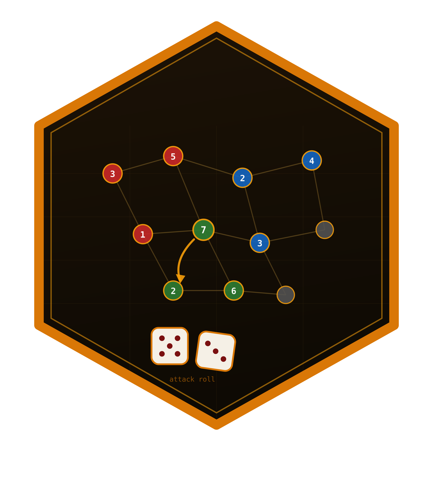

<!-- README.md is generated from README.Rmd. Please edit that file -->

```{r, include = FALSE}
knitr::opts_chunk$set(
  collapse = TRUE,
  comment = "#>",
  fig.path = "man/figures/README-",
  out.width = "100%",
  dpi = 110
)
```

# risikoR 

<!-- badges: start -->
[](https://github.com/r-heller/risikoR/actions/workflows/R-CMD-check.yaml)
[](https://github.com/r-heller/risikoR/actions/workflows/pkgdown.yaml)
[](https://CRAN.R-project.org/package=risikoR)
[](https://app.codecov.io/gh/r-heller/risikoR?branch=main)
[](https://cran.r-project.org/package=risikoR)
[](https://cran.r-project.org/package=risikoR)
[](https://opensource.org/licenses/MIT)
[](https://lifecycle.r-lib.org/articles/stages.html#experimental)
<!-- badges: end -->

Simulate, analyse and play the board game **Risk** (German *Risiko*) in R:
the exact dice-combat engine, battle and whole-game simulators, a scriptable
game model with AI agents, a ggplot2 map layer, and an interactive Shiny app.

The whole-game engine is a conquest variant: it omits card trading, secret
missions, and the printed two-player neutral-army setup. Dice, reinforcement,
conquest, elimination and fortification are implemented. Conquest must move at
least the number of dice used in the final attack round and leave one army behind.

## Installation

```r
# install.packages("remotes")
remotes::install_github("r-heller/risikoR")
```

## The dice

The attacker rolls up to three dice, the defender up to two, and the highest
dice are compared pairwise. The attacker wins a pair only by rolling strictly
higher — ties go to the defender. Every outcome is enumerated exactly, never
simulated:

```{r duel}
library(risikoR)

rk_duel_dist(3, 2)
```

```{r odds}
rk_duel_odds(3, 2)
```

## The battles

`rk_battle()` fights a territory out; `rk_battle_odds()` gives the win
probability either by Monte Carlo or by solving the Markov chain exactly.

```{r battle}
set.seed(1)
rk_battle(10, 8)

rk_battle_odds(10, 8, method = "exact")
```

An attacker needs roughly a 5-to-4 advantage for even odds:

```{r conquest, fig.height = 4}
rk_plot_conquest(20, def_range = 1:25, method = "exact")
```

## The game

`rk_game()` deals the classic 42-territory board; the turn cycle is
`rk_reinforce()` -> `rk_attack()` -> `rk_fortify()` -> `rk_end_turn()`, and
every one of them returns a new game rather than modifying the old one.

```{r map, fig.width = 9.6, fig.height = 6.8}
game <- rk_game(c("Red", "Blue", "Green"), seed = 1)
game

rk_plot_map(game)
```

## The agents

`rk_ai()` builds a policy, `rk_play()` runs a whole game and `rk_tournament()`
compares strategies over many games.

```{r play}
set.seed(1)
rk_play(
  rk_game(c("Red", "Blue"), seed = 3),
  policies = c(Red = "aggressive", Blue = "cautious"),
  max_rounds = 30
)
```

## The app

```r
rk_run_app()
```

Four tabs: play against the agents on a clickable map, analyse a single duel,
simulate battles against the exact solution, and run tournaments in the
strategy lab.

## Learn more

* `vignette("risikoR")` — the guided tour
* [Playing a game](https://r-heller.github.io/risikoR/articles/playing.html)
* [The probability of Risk](https://r-heller.github.io/risikoR/articles/strategy.html)

## Local maintenance candidate

See [MAINTENANCE.md](MAINTENANCE.md) for the 30 October 2026 repairs, exact local
installation path, verification results and remaining release limits.
