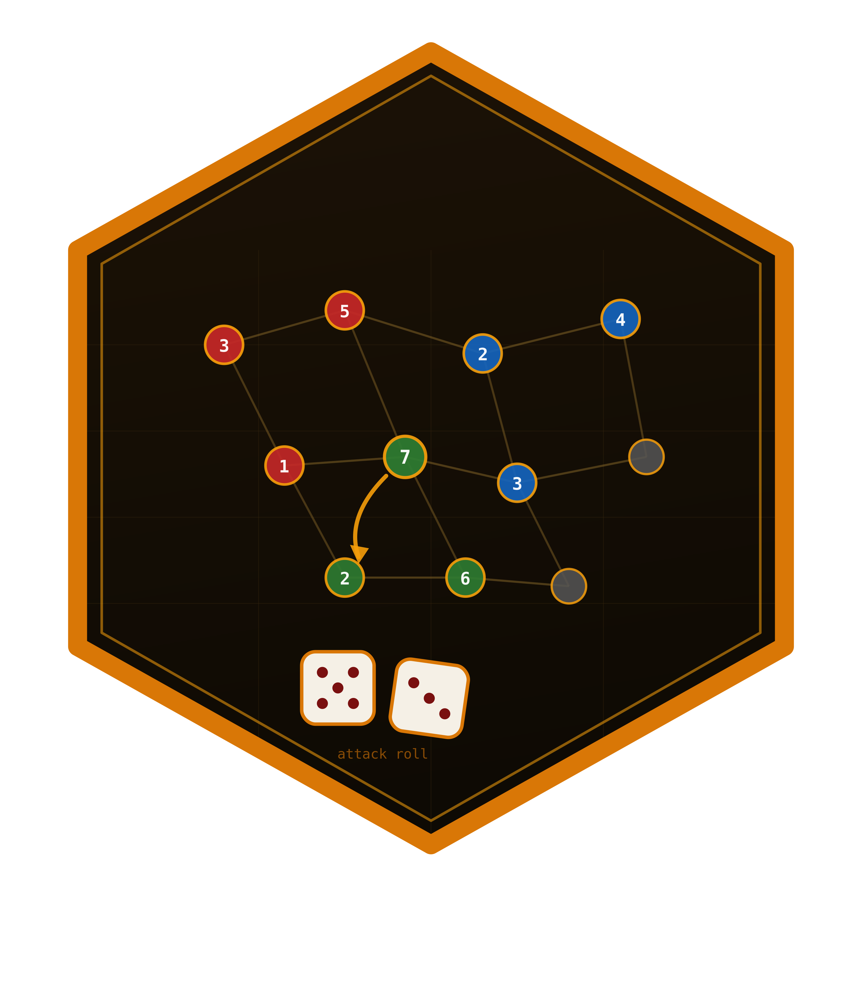
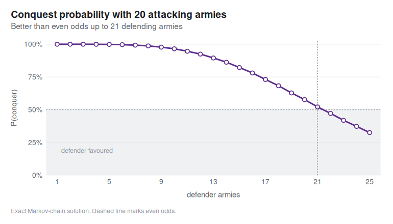
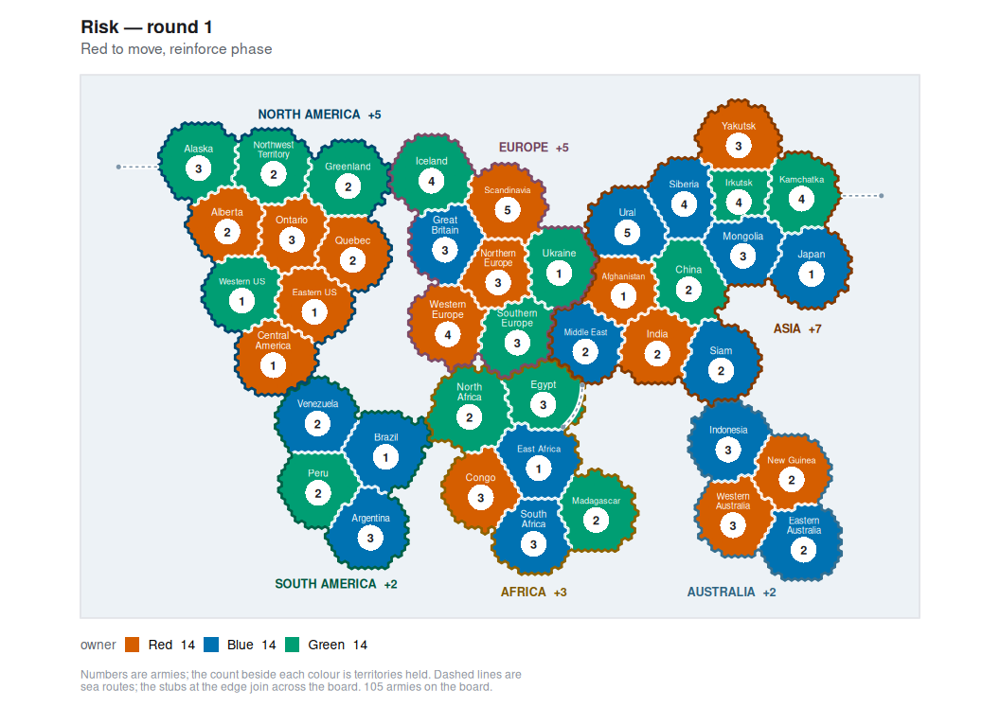

<!-- README.md is generated from README.Rmd. Please edit that file -->

# risikoR 

<!-- badges: start -->

[](https://github.com/r-heller/risikoR/actions/workflows/R-CMD-check.yaml)
[](https://github.com/r-heller/risikoR/actions/workflows/pkgdown.yaml)
[](https://CRAN.R-project.org/package=risikoR)
[](https://app.codecov.io/gh/r-heller/risikoR?branch=main)
[](https://cran.r-project.org/package=risikoR)
[](https://cran.r-project.org/package=risikoR)
[](https://opensource.org/licenses/MIT)
[](https://lifecycle.r-lib.org/articles/stages.html#experimental)
<!-- badges: end -->

Simulate, analyse and play the board game **Risk** (German *Risiko*) in
R: the exact dice-combat engine, battle and whole-game simulators, a
scriptable game model with AI agents, a ggplot2 map layer, and an
interactive Shiny app.

## Installation

``` r
# install.packages("remotes")
remotes::install_github("r-heller/risikoR")
```

## The dice

The attacker rolls up to three dice, the defender up to two, and the
highest dice are compared pairwise. The attacker wins a pair only by
rolling strictly higher — ties go to the defender. Every outcome is
enumerated exactly, never simulated:

``` r
library(risikoR)

rk_duel_dist(3, 2)
#> # A tibble: 3 × 5
#>   n_att n_def att_loss def_loss     p
#>   <int> <int>    <int>    <int> <dbl>
#> 1     3     2        0        2 0.372
#> 2     3     2        1        1 0.336
#> 3     3     2        2        0 0.293
```

``` r
rk_duel_odds(3, 2)
#> # A tibble: 1 × 8
#>   n_att n_def e_att_loss e_def_loss sd_loss p_att_wins_all p_def_wins_all
#>   <int> <int>      <dbl>      <dbl>   <dbl>          <dbl>          <dbl>
#> 1     3     2      0.921       1.08   0.811          0.372          0.293
#> # ℹ 1 more variable: p_split <dbl>
```

## The battles

`rk_battle()` fights a territory out; `rk_battle_odds()` gives the win
probability either by Monte Carlo or by solving the Markov chain
exactly.

``` r
set.seed(1)
rk_battle(10, 8)
#> <rk_battle> territory conquered after 8 duels
#> Attacker: 3 left · Defender: 0 left

rk_battle_odds(10, 8, method = "exact")
#> # A tibble: 1 × 7
#>   att_armies def_armies method     n p_conquer e_att_survivors e_def_survivors
#>        <int>      <int> <chr>  <int>     <dbl>           <dbl>           <dbl>
#> 1         10          8 exact     NA     0.646            4.05            1.23
```

An attacker needs roughly a 5-to-4 advantage for even odds:

``` r
rk_plot_conquest(20, def_range = 1:25, method = "exact")
```



## The game

`rk_game()` deals the classic 42-territory board; the turn cycle is
`rk_reinforce()` -\> `rk_attack()` -\> `rk_fortify()` -\>
`rk_end_turn()`, and every one of them returns a new game rather than
modifying the old one.

``` r
game <- rk_game(c("Red", "Blue", "Green"), seed = 1)
game
#> <rk_game> 3 players on 42 territories, round 1
#> Turn: Red (reinforce phase)
#> * Red: 14 territories, 35 armies, 0 continents
#>   Blue: 14 territories, 35 armies, 0 continents
#>   Green: 14 territories, 35 armies, 0 continents

rk_plot_map(game)
```



## The agents

`rk_ai()` builds a policy, `rk_play()` runs a whole game and
`rk_tournament()` compares strategies over many games.

``` r
set.seed(1)
rk_play(
  rk_game(c("Red", "Blue"), seed = 3),
  policies = c(Red = "aggressive", Blue = "cautious"),
  max_rounds = 30
)
#> <rk_game_result> 2 players
#> Winner: Red after 13 rounds
#> Policies: Red (aggressive) and Blue (cautious)
```

## The app

``` r
rk_run_app()
```

Four tabs: play against the agents on a clickable map, analyse a single
duel, simulate battles against the exact solution, and run tournaments
in the strategy lab.

## Learn more

- `vignette("risikoR")` — the guided tour
- [Playing a
  game](https://r-heller.github.io/risikoR/articles/playing.html)
- [The probability of
  Risk](https://r-heller.github.io/risikoR/articles/strategy.html)
