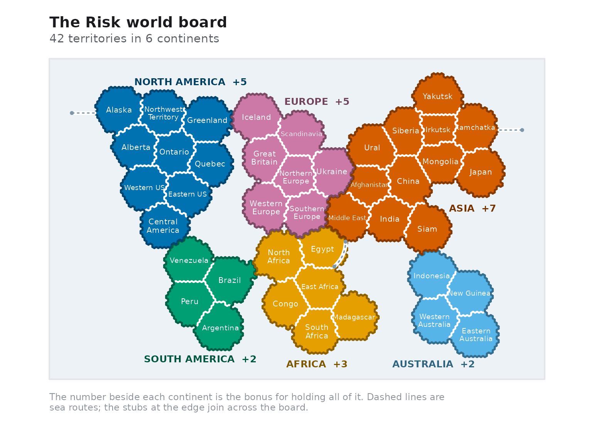
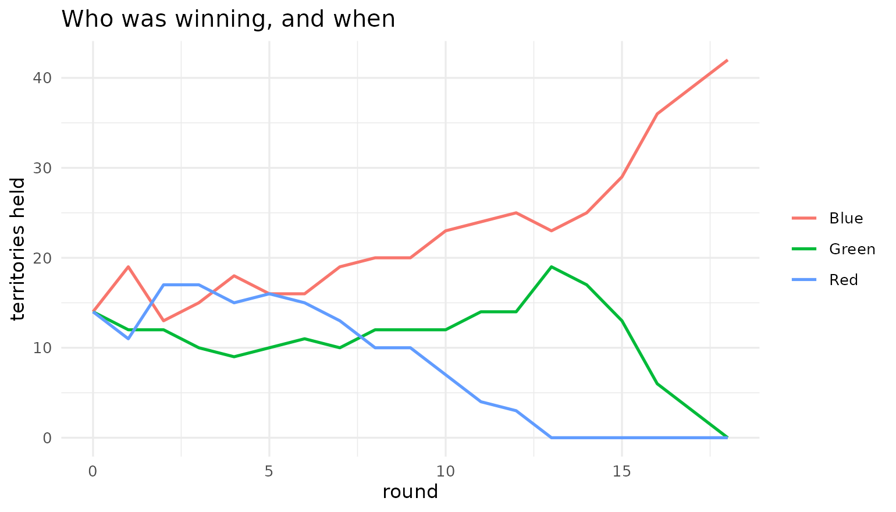
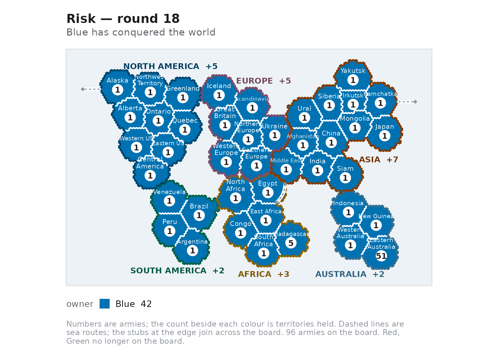

# Playing a game

``` r

library(risikoR)
```

This article scripts a whole game: setting up the board, taking a turn
by hand, handing the turn to an AI agent, and reading the map.

## The board

[`rk_world()`](https://r-heller.github.io/risikoR/reference/rk_world.md)
returns the classic 42-territory board as an `rk_map`.

``` r

world <- rk_world()
world
#> <rk_map> 42 territories, 6 continents
#> Bonuses: North_America +5, South_America +2, Europe +5, Africa +3, Asia +7, and Australia +2
world$continent_bonus
#> North_America South_America        Europe        Africa          Asia 
#>             5             2             5             3             7 
#>     Australia 
#>             2
rk_neighbors(world, "Brazil")
#> [1] "Venezuela"    "Peru"         "Argentina"    "North_Africa"
```

Plotting the map alone shows the adjacency graph coloured by continent.
Note Alaska and Kamchatka: the board wraps around, so the segment
between them crosses the whole picture.

``` r

rk_plot_map(world)
```



Custom boards are welcome;
[`rk_map()`](https://r-heller.github.io/risikoR/reference/rk_map.md)
validates the graph (it must be symmetric, and every territory must
belong to exactly one continent) and lays out any board you give it on a
circle when you supply no coordinates.

``` r

mini <- rk_map(
  territories = c("A", "B", "C", "D"),
  adjacency = list(
    A = c("B", "C"), B = c("A", "D"), C = c("A", "D"), D = c("B", "C")
  ),
  continent = list(North = c("A", "B"), South = c("C", "D")),
  continent_bonus = c(North = 2, South = 3)
)
mini
#> <rk_map> 4 territories, 2 continents
#> Bonuses: North +2 and South +3
```

## Dealing a game

``` r

game <- rk_game(c("Red", "Blue", "Green"), seed = 2024)
game
#> <rk_game> 3 players on 42 territories, round 1
#> Turn: Red (reinforce phase)
#> * Red: 14 territories, 35 armies, 0 continents
#>   Blue: 14 territories, 35 armies, 0 continents
#>   Green: 14 territories, 35 armies, 0 continents
```

Each player is dealt an equal share of the territories and spreads the
standard number of starting armies (35 for three players) over them.

``` r

summary(game)
#> # A tibble: 3 × 6
#>   player territories armies continents reinforcements alive
#>   <chr>        <int>  <int>      <int>          <int> <lgl>
#> 1 Red             14     35          0              4 TRUE 
#> 2 Blue            14     35          0              4 TRUE 
#> 3 Green           14     35          0              4 TRUE
```

## One turn by hand

A turn runs in three phases. Every function returns a **new** game, so
you can keep the old one and compare, replay or branch.

### Reinforce

The allowance is one army per three territories, never fewer than three,
plus the bonus for every continent held outright.

``` r

rk_reinforcements(game, "Red")
#> [1] 4
```

Placements are a named vector that must account for every army:

``` r

front <- rk_legal_attacks(game, "Red")
head(front, 3)
#> # A tibble: 3 × 5
#>   from                to      defender att_armies def_armies
#>   <chr>               <chr>   <chr>         <int>      <int>
#> 1 Northwest_Territory Alaska  Blue              3          2
#> 2 Northwest_Territory Alberta Blue              3          3
#> 3 Northwest_Territory Ontario Green             3          3

placements <- c(rk_reinforcements(game, "Red"))
names(placements) <- front$from[[1]]
game <- rk_reinforce(game, "Red", placements)
game$phase
#> [1] "attack"
```

### Attack

``` r

set.seed(7)
targets <- rk_legal_attacks(game, "Red")
best <- targets[which.min(targets$def_armies), ]
best
#> # A tibble: 1 × 5
#>   from  to        defender att_armies def_armies
#>   <chr> <chr>     <chr>         <int>      <int>
#> 1 Peru  Argentina Green             2          1

game <- rk_attack(game, best$from, best$to)
game$last_battle
#> <rk_battle> territory repelled after 1 duel
#> Attacker: 1 left · Defender: 1 left
rk_owner(game, best$to)
#> [1] "Green"
```

The attack is resolved by
[`rk_battle()`](https://r-heller.github.io/risikoR/reference/rk_battle.md)
internally, so the same odds apply as in the combat engine — and
[`rk_battle_odds()`](https://r-heller.github.io/risikoR/reference/rk_battle_odds.md)
will tell you beforehand what you are getting into:

``` r

rk_battle_odds(best$att_armies, best$def_armies, method = "exact")
#> # A tibble: 1 × 7
#>   att_armies def_armies method     n p_conquer e_att_survivors e_def_survivors
#>        <int>      <int> <chr>  <int>     <dbl>           <dbl>           <dbl>
#> 1          2          1 exact     NA     0.417            1.42           0.583
```

### Fortify and hand over

One move along a path of your own territories ends the turn.

``` r

own <- rk_territories(game, "Red")
from <- own[which.max(rk_armies(game, own))]
reachable <- intersect(rk_neighbors(game, from), own)
if (length(reachable) > 0 && rk_armies(game, from) > 1) {
  game <- rk_fortify(game, from, reachable[[1]], 1)
}
game <- rk_end_turn(game)
game$turn
#> [1] "Blue"
```

## Letting the agents finish it

[`rk_ai()`](https://r-heller.github.io/risikoR/reference/rk_ai.md)
returns a policy — a function of `(game, player)` that proposes an
action.
[`rk_step()`](https://r-heller.github.io/risikoR/reference/rk_step.md)
applies one action;
[`rk_play()`](https://r-heller.github.io/risikoR/reference/rk_play.md)
runs the whole game.

``` r

bot <- rk_ai("aggressive")
bot(game, game$turn)$action
#> [1] "reinforce"
```

``` r

set.seed(11)
result <- rk_play(
  game,
  policies = c(Red = "aggressive", Blue = "cautious", Green = "random"),
  max_rounds = 40
)
result
#> <rk_game_result> 3 players
#> Winner: Blue after 18 rounds
#> Policies: Red (aggressive), Blue (cautious), and Green (random)
```

The result carries the standings for every round, which makes the shape
of the game easy to see:

``` r

standings <- result$standings
ggplot2::ggplot(
  standings,
  ggplot2::aes(round, territories, colour = player)
) +
  ggplot2::geom_line(linewidth = 0.8) +
  ggplot2::labs(
    x = "round", y = "territories held", colour = NULL,
    title = "Who was winning, and when"
  ) +
  ggplot2::theme_minimal()
```



``` r

rk_plot_map(result$game)
```



## Writing your own agent

A policy is any function of `(game, player)` that returns an action
list, so a new strategy is a few lines. This one always reinforces its
weakest territory and never attacks:

``` r

turtle <- function(game, player) {
  if (identical(game$phase, "reinforce")) {
    own <- rk_territories(game, player)
    placements <- rk_reinforcements(game, player)
    names(placements) <- own[which.min(rk_armies(game, own))]
    return(list(action = "reinforce", placements = placements))
  }
  list(action = "end_turn")
}

set.seed(5)
turtle_result <- rk_play(
  rk_game(c("Red", "Blue"), seed = 5),
  policies = list(Red = rk_ai("aggressive"), Blue = turtle),
  max_rounds = 25
)
turtle_result
#> <rk_game_result> 2 players
#> Winner: Red after 8 rounds
#> Policies: Red (custom) and Blue (custom)
```

Turtling does not work. Neither does anything else, reliably — which is
why
[`rk_tournament()`](https://r-heller.github.io/risikoR/reference/rk_tournament.md)
exists.

## The app

[`rk_run_app()`](https://r-heller.github.io/risikoR/reference/rk_run_app.md)
opens a four-tab Shiny application: play against the agents on a
clickable map, analyse a single duel, simulate battles against the exact
solution, and run tournaments in the strategy lab.
