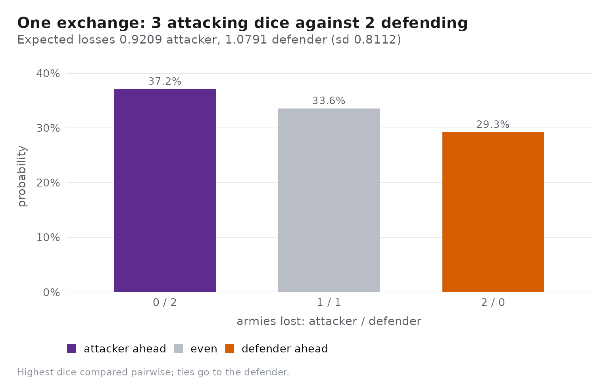
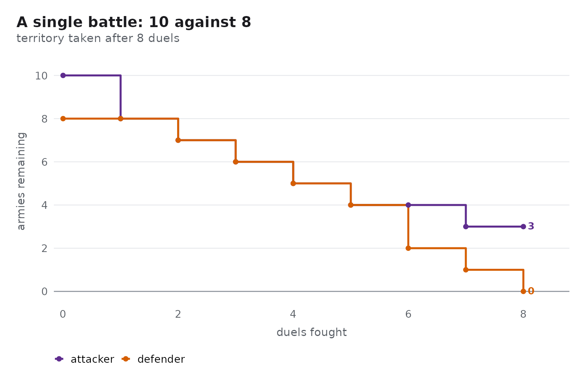
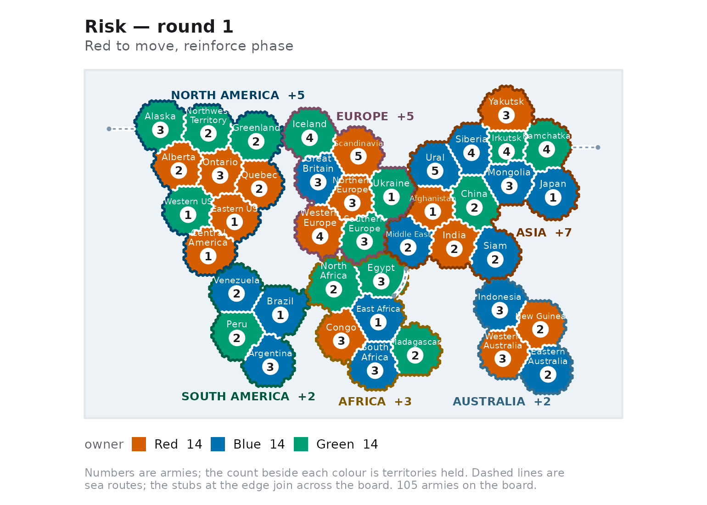

# Getting started with risikoR

``` r

library(risikoR)
```

`risikoR` has four layers, each usable on its own:

- the **combat engine** —
  [`rk_duel()`](https://r-heller.github.io/risikoR/reference/rk_duel.md),
  [`rk_duel_dist()`](https://r-heller.github.io/risikoR/reference/rk_duel_dist.md),
  [`rk_duel_odds()`](https://r-heller.github.io/risikoR/reference/rk_duel_odds.md);
- the **battle simulator** —
  [`rk_battle()`](https://r-heller.github.io/risikoR/reference/rk_battle.md),
  [`rk_battle_odds()`](https://r-heller.github.io/risikoR/reference/rk_battle_odds.md),
  [`rk_odds_table()`](https://r-heller.github.io/risikoR/reference/rk_odds_table.md);
- the **game model** —
  [`rk_game()`](https://r-heller.github.io/risikoR/reference/rk_game.md)
  plus the turn cycle and the AI agents;
- the **plot layer** —
  [`rk_plot_map()`](https://r-heller.github.io/risikoR/reference/rk_plot_map.md)
  and friends, all returning ggplot objects.

## The dice duel

The heart of Risk is a dice duel. The attacker rolls up to three dice,
the defender up to two, and the highest dice are compared pairwise. The
attacker must roll *strictly* higher: ties go to the defender.

``` r

set.seed(1)
rk_duel(3, 2)
#> $att_loss
#> [1] 2
#> 
#> $def_loss
#> [1] 0
#> 
#> $att_roll
#> [1] 4 1 1
#> 
#> $def_roll
#> [1] 5 2
```

[`rk_duel_dist()`](https://r-heller.github.io/risikoR/reference/rk_duel_dist.md)
enumerates all `6^3 * 6^2 = 7776` equally likely combinations, so the
probabilities are exact rather than simulated:

``` r

rk_duel_dist(3, 2)
#> # A tibble: 3 × 5
#>   n_att n_def att_loss def_loss     p
#>   <int> <int>    <int>    <int> <dbl>
#> 1     3     2        0        2 0.372
#> 2     3     2        1        1 0.336
#> 3     3     2        2        0 0.293
```

[`rk_duel_odds()`](https://r-heller.github.io/risikoR/reference/rk_duel_odds.md)
summarises the same enumeration:

``` r

rk_duel_odds(3, 2)
#> # A tibble: 1 × 8
#>   n_att n_def e_att_loss e_def_loss sd_loss p_att_wins_all p_def_wins_all
#>   <int> <int>      <dbl>      <dbl>   <dbl>          <dbl>          <dbl>
#> 1     3     2      0.921       1.08   0.811          0.372          0.293
#> # ℹ 1 more variable: p_split <dbl>
```

The attacker expects to lose 0.92 armies and the defender 1.08 per
three-on-two duel — the standard textbook values.

``` r

rk_plot_duel(3, 2)
```



## A full battle

[`rk_battle()`](https://r-heller.github.io/risikoR/reference/rk_battle.md)
keeps rolling until the attacker runs out of spare armies or the
defender is wiped out.

``` r

set.seed(1)
battle <- rk_battle(10, 8)
battle
#> <rk_battle> territory conquered after 8 duels
#> Attacker: 3 left · Defender: 0 left
```

Every battle carries its own log, which
[`autoplot()`](https://ggplot2.tidyverse.org/reference/autoplot.html)
turns into a picture of the fight:

``` r

ggplot2::autoplot(battle)
```



## Conquest probability

[`rk_battle_odds()`](https://r-heller.github.io/risikoR/reference/rk_battle_odds.md)
answers the question that actually matters at the table: will this
attack succeed? The `"exact"` method solves the underlying Markov chain,
so no simulation error is involved; `"mc"` simulates instead.

``` r

rk_battle_odds(20, 15, method = "exact")
#> # A tibble: 1 × 7
#>   att_armies def_armies method     n p_conquer e_att_survivors e_def_survivors
#>        <int>      <int> <chr>  <int>     <dbl>           <dbl>           <dbl>
#> 1         20         15 exact     NA     0.822            7.83           0.719

set.seed(1)
rk_battle_odds(20, 15, n = 1000)
#> # A tibble: 1 × 7
#>   att_armies def_armies method     n p_conquer e_att_survivors e_def_survivors
#>        <int>      <int> <chr>  <int>     <dbl>           <dbl>           <dbl>
#> 1         20         15 mc      1000     0.827            8.02           0.682
```

Ten attackers beat five defenders about four times in five; the same ten
against fifteen almost never win:

``` r

rk_odds_table(att_range = c(10, 20), def_range = c(5, 15))
#> # A tibble: 4 × 6
#>   att_armies def_armies method p_conquer e_att_survivors e_def_survivors
#>        <int>      <int> <chr>      <dbl>           <dbl>           <dbl>
#> 1         10          5 exact      0.873            6.07         0.305  
#> 2         10         15 exact      0.173            1.61         6.02   
#> 3         20          5 exact      0.999           16.0          0.00294
#> 4         20         15 exact      0.822            7.83         0.719
```

## Setting up a game

[`rk_game()`](https://r-heller.github.io/risikoR/reference/rk_game.md)
deals the 42 territories of the classic board and spreads each player’s
starting armies over them.

``` r

game <- rk_game(c("Red", "Blue", "Green"), seed = 1)
game
#> <rk_game> 3 players on 42 territories, round 1
#> Turn: Red (reinforce phase)
#> * Red: 14 territories, 35 armies, 0 continents
#>   Blue: 14 territories, 35 armies, 0 continents
#>   Green: 14 territories, 35 armies, 0 continents
```

``` r

summary(game)
#> # A tibble: 3 × 6
#>   player territories armies continents reinforcements alive
#>   <chr>        <int>  <int>      <int>          <int> <lgl>
#> 1 Red             14     35          0              4 TRUE 
#> 2 Blue            14     35          0              4 TRUE 
#> 3 Green           14     35          0              4 TRUE
```

``` r

rk_plot_map(game)
```



## Taking a turn

A turn runs `reinforce` -\> `attack` -\> `fortify`, and every mutator
returns a new game object rather than changing the old one.

``` r

placements <- rk_reinforcements(game, "Red")
names(placements) <- rk_territories(game, "Red")[[1]]
placements
#> Alberta 
#>       4

game <- rk_reinforce(game, "Red", placements)
game$phase
#> [1] "attack"
```

``` r

head(rk_legal_attacks(game, "Red"), 3)
#> # A tibble: 3 × 5
#>   from    to                  defender att_armies def_armies
#>   <chr>   <chr>               <chr>         <int>      <int>
#> 1 Alberta Alaska              Green             6          3
#> 2 Alberta Northwest_Territory Green             6          2
#> 3 Alberta Western_US          Green             6          1
```

``` r

set.seed(42)
targets <- rk_legal_attacks(game, "Red")
game <- rk_attack(game, targets$from[[1]], targets$to[[1]])
game$last_battle
#> <rk_battle> territory conquered after 3 duels
#> Attacker: 4 left · Defender: 0 left
```

## Letting the machine play

[`rk_ai()`](https://r-heller.github.io/risikoR/reference/rk_ai.md)
builds a policy;
[`rk_play()`](https://r-heller.github.io/risikoR/reference/rk_play.md)
runs a whole game with one policy per player.

``` r

set.seed(1)
result <- rk_play(
  rk_game(c("Red", "Blue"), seed = 3),
  policies = c(Red = "aggressive", Blue = "cautious"),
  max_rounds = 30
)
result
#> <rk_game_result> 2 players
#> Winner: Red after 13 rounds
#> Policies: Red (aggressive) and Blue (cautious)
tail(result$standings, 4)
#> # A tibble: 4 × 7
#>   round player territories armies continents reinforcements alive
#>   <int> <chr>        <int>  <int>      <int>          <int> <lgl>
#> 1    12 Red             35    175          4             26 TRUE 
#> 2    12 Blue             7      7          1              5 TRUE 
#> 3    13 Red             42    199          6             38 TRUE 
#> 4    13 Blue             0      0          0              0 FALSE
```

[`rk_tournament()`](https://r-heller.github.io/risikoR/reference/rk_tournament.md)
repeats that many times and reports the win rates, and
[`rk_run_app()`](https://r-heller.github.io/risikoR/reference/rk_run_app.md)
opens the interactive Shiny application for playing, simulating and
analysing games.

Two further articles go deeper: [playing a
game](https://r-heller.github.io/risikoR/articles/playing.html) and [the
probability of
Risk](https://r-heller.github.io/risikoR/articles/strategy.html).
