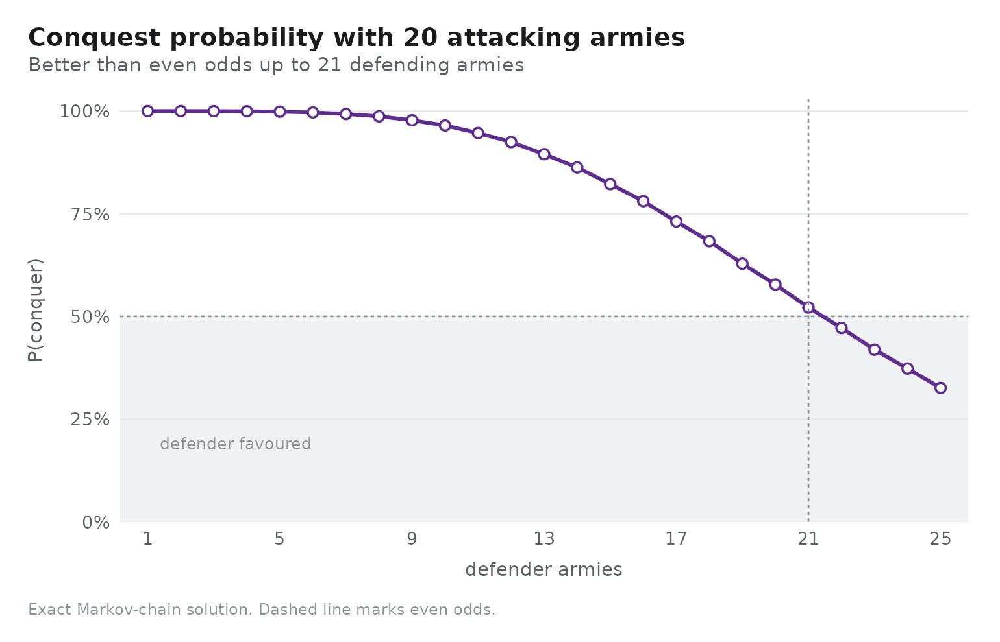
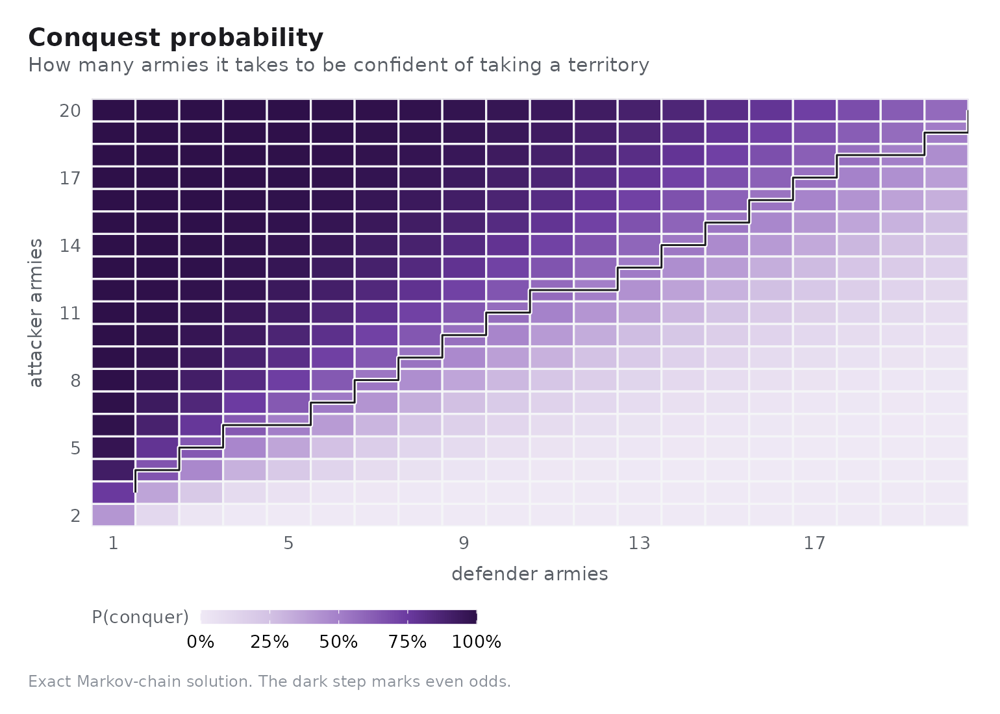
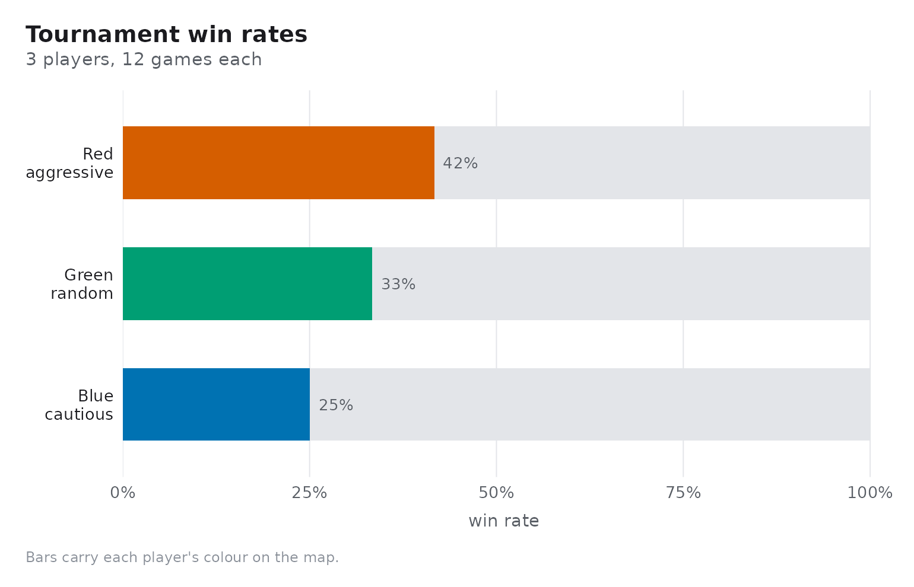

# The probability of Risk

``` r

library(risikoR)
```

Risk looks like a game of luck. It is, but the luck is completely
characterised: every roll of the dice has an exact distribution, every
battle is an absorbing Markov chain, and both can be written down. This
article walks from one throw of the dice up to whole-game win rates.

## One throw of the dice

There are `6^n_att * 6^n_def` equally likely combinations, few enough to
enumerate exhaustively.
[`rk_duel_dist()`](https://r-heller.github.io/risikoR/reference/rk_duel_dist.md)
does exactly that.

``` r

rk_duel_dist(3, 2)
#> # A tibble: 3 × 5
#>   n_att n_def att_loss def_loss     p
#>   <int> <int>    <int>    <int> <dbl>
#> 1     3     2        0        2 0.372
#> 2     3     2        1        1 0.336
#> 3     3     2        2        0 0.293
```

Three attacking dice against two defending dice is the standard case,
and it is worth memorising: the attacker loses nothing about 37% of the
time, trades one for one about 34% of the time, and loses two about 29%
of the time.

Comparing every legal dice pairing shows how much the extra dice are
worth:

``` r

pairings <- expand.grid(n_att = 1:3, n_def = 1:2)
odds <- do.call(
  rbind,
  Map(rk_duel_odds, pairings$n_att, pairings$n_def)
)
odds[order(odds$n_def, odds$n_att), ]
#> # A tibble: 6 × 8
#>   n_att n_def e_att_loss e_def_loss sd_loss p_att_wins_all p_def_wins_all
#>   <int> <int>      <dbl>      <dbl>   <dbl>          <dbl>          <dbl>
#> 1     1     1      0.583      0.417   0.493          0.417          0.583
#> 2     2     1      0.421      0.579   0.494          0.579          0.421
#> 3     3     1      0.340      0.660   0.474          0.660          0.340
#> 4     1     2      0.745      0.255   0.436          0.255          0.745
#> 5     2     2      1.22       0.779   0.792          0.228          0.448
#> 6     3     2      0.921      1.08    0.811          0.372          0.293
#> # ℹ 1 more variable: p_split <dbl>
```

Two lessons fall out. Rolling three dice instead of one roughly halves
the attacker’s expected loss, so never attack with fewer armies than you
need for three dice. And the defender’s second die is worth more than
the attacker’s third: with two defending dice the attacker loses more
armies than the defender in every pairing.

## The whole battle

A battle repeats the duel until one side runs out. Because each duel
removes a fixed number of armies, the process is an absorbing Markov
chain over states `(attacker armies, defender armies)` — which
`rk_battle_odds(method = "exact")` solves directly.

``` r

rk_battle_odds(10, 8, method = "exact")
#> # A tibble: 1 × 7
#>   att_armies def_armies method     n p_conquer e_att_survivors e_def_survivors
#>        <int>      <int> <chr>  <int>     <dbl>           <dbl>           <dbl>
#> 1         10          8 exact     NA     0.646            4.05            1.23
```

The Monte Carlo estimate converges to it:

``` r

set.seed(1)
mc <- do.call(rbind, lapply(
  c(100, 1000, 10000),
  function(n) rk_battle_odds(10, 8, n = n)
))
mc$exact <- rk_battle_odds(10, 8, method = "exact")$p_conquer
mc[, c("n", "p_conquer", "exact")]
#> # A tibble: 3 × 3
#>       n p_conquer exact
#>   <int>     <dbl> <dbl>
#> 1   100     0.56  0.646
#> 2  1000     0.642 0.646
#> 3 10000     0.651 0.646
```

Holding the attacker fixed and varying the defender traces the conquest
curve:

``` r

rk_plot_conquest(20, def_range = 1:25, method = "exact")
```



The crossing point is the number to remember: an attacker needs roughly
a **5-to-4 advantage** for even odds, and about a 3-to-2 advantage to be
comfortable.

``` r

odds_grid <- rk_odds_table(att_range = 2:20, def_range = 1:20)
even <- do.call(rbind, lapply(split(odds_grid, odds_grid$def_armies), function(d) {
  win <- d[d$p_conquer >= 0.5, ]
  if (nrow(win) == 0) return(NULL)
  win[1, c("def_armies", "att_armies", "p_conquer")]
}))
head(even, 10)
#> # A tibble: 10 × 3
#>    def_armies att_armies p_conquer
#>         <int>      <int>     <dbl>
#>  1          1          3     0.754
#>  2          2          4     0.656
#>  3          3          5     0.642
#>  4          4          6     0.638
#>  5          5          6     0.506
#>  6          6          7     0.521
#>  7          7          8     0.536
#>  8          8          9     0.547
#>  9          9         10     0.558
#> 10         10         11     0.568
```

The whole surface at once:

``` r

rk_plot_odds_heatmap(att_range = 2:20, def_range = 1:20)
```



## From battles to games

Exact odds do not settle the game, because a game is a sequence of
decisions about *which* battles to fight. The built-in agents encode
three answers:

- `"random"` attacks at random,
- `"aggressive"` attacks the weakest reachable enemy while it outnumbers
  them,
- `"cautious"` attacks only above an army ratio and otherwise
  consolidates.

[`rk_tournament()`](https://r-heller.github.io/risikoR/reference/rk_tournament.md)
deals a fresh board for every game and plays it out.

``` r

results <- rk_tournament(
  c(Red = "aggressive", Blue = "cautious", Green = "random"),
  n_games = 12,
  max_rounds = 40,
  seed = 1
)
results
#> # A tibble: 3 × 7
#>   player strategy   games  wins win_rate mean_territories mean_rounds
#>   <chr>  <chr>      <int> <int>    <dbl>            <dbl>       <dbl>
#> 1 Red    aggressive    12     5    0.417             17.5        18.2
#> 2 Blue   cautious      12     3    0.25              10.5        18.2
#> 3 Green  random        12     4    0.333             14          18.2
```

``` r

rk_plot_tournament(results)
```



Win rates depend on the round cap: aggression is rewarded when games are
cut short, patience when they are allowed to run.

``` r

caps <- do.call(rbind, lapply(c(10, 40), function(cap) {
  out <- rk_tournament(
    c(Red = "aggressive", Blue = "cautious"),
    n_games = 8, max_rounds = cap, seed = 2
  )
  out$max_rounds <- cap
  out
}))
caps[, c("max_rounds", "player", "strategy", "win_rate", "mean_rounds")]
#> # A tibble: 4 × 5
#>   max_rounds player strategy   win_rate mean_rounds
#>        <dbl> <chr>  <chr>         <dbl>       <dbl>
#> 1         10 Red    aggressive     0.25        8   
#> 2         10 Blue   cautious       0.5         8   
#> 3         40 Red    aggressive     0.75        8.38
#> 4         40 Blue   cautious       0.25        8.38
```

## Where the model stops

The engine implements the combat rules exactly, but a full game of Risk
also has cards, sets traded for armies, and the rule that a conquering
player draws a card. Those are not modelled here, so tournament win
rates describe *these* agents on *this* board rather than the printed
game in full.
